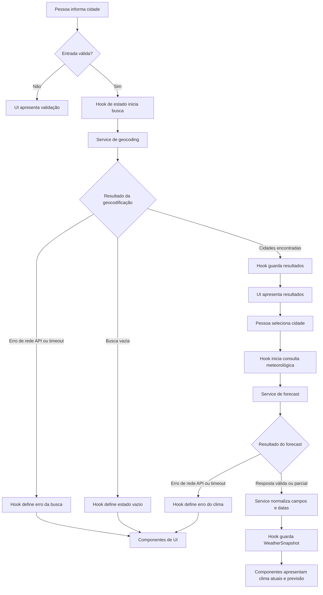

# Plano Técnico — Weather App

Este plano deriva de [`specs/weather-app-spec.md`](../specs/weather-app-spec.md).
As referências RF, RNF e AC indicam os requisitos e critérios de aceite que
fundamentam cada decisão. O documento define arquitetura e contratos; não é a
implementação final.

## Architecture

Aplicação web client-side, sem servidor próprio. O código é separado em quatro
camadas com fluxo de dependências unidirecional:

```text
App.tsx (composição)
  ├── components/ (apresentação via props e callbacks)
  └── hooks/ (orquestração e estado)
        ├── services/ (acesso HTTP) ──► Open-Meteo APIs
        └── lib/ (funções puras)

services/ ────────────────────────────► lib/
```

- `components/` contém componentes React de apresentação: recebe dados e
  callbacks por props, renderiza loading/vazio/erro/dados e não chama APIs.
- `App.tsx` é o ponto de composição: usa o hook e distribui estado e callbacks
  aos componentes. Componentes não importam hooks diretamente.
- `hooks/` coordena o fluxo da página e mantém estado local: valida o momento
  das operações, chama os serviços, controla cancelamento/timeout e ignora
  respostas obsoletas. Não contém detalhes de renderização ou de URL.
- `services/` contém as integrações HTTP: constrói requisições Open-Meteo,
  verifica HTTP/JSON, traduz o contrato externo para modelos da aplicação e
  recebe sinal de cancelamento. Não depende de React.
- `lib/` contém funções puras e sem efeitos colaterais: validação e
  normalização de valores, mapa de códigos WMO, cálculos/conversões e
  formatação. Pode ser usada por serviços e apresentação sem importar camada
  React.
- Dependências permitidas: `App → hooks` e `App → components`, `hooks →
  services` e `hooks → lib`, `services → lib`. Componentes recebem dados e
  callbacks do `App`; `lib` não importa outras camadas; `services` não importa
  `components` nem `hooks`.

- A busca só consulta a geocodificação após envio explícito; a primeira cidade
  encontrada é consultada automaticamente e a lista permanece disponível para
  selecionar outra cidade (RF-01).
- A consulta meteorológica usa uma única chamada de previsão com condições
  atuais e dados diários. Isso mantém uma única operação, timeout e recuperação
  para os dados da cidade (RF-02, RF-03, RF-05). A orquestração do timeout fica
  no hook; o service recebe o `AbortSignal` e propaga falhas de transporte ou
  contrato.
- A UI apresenta carregamento, vazio, falha e indisponibilidade sem misturar
  essas situações. Dados parciais continuam visíveis campo a campo (RF-05,
  RF-06).

## Tech Stack

| Tecnologia | Uso e justificativa |
|---|---|
| TypeScript strict | Contratos explícitos para modelos normalizados, estados e respostas externas. |
| React 19 | UI por componentes e estado local da página, suficiente para o fluxo sem adicionar uma biblioteca de estado. |
| Vite | Servidor de desenvolvimento e build já configurados no projeto. |
| Tailwind CSS | Estilização responsiva conforme o tema dark glassmorphism do projeto. |
| Fetch API | Chamadas HTTP sem dependência adicional; `AbortController` permite cancelar operações. |
| Vitest e Testing Library | Testes unitários e de componentes no stack existente. |
| Playwright | Testes E2E dos fluxos e estados observáveis da aplicação. |
| `Intl` do navegador | Formatação pt-BR de números, datas e horários, respeitando o fuso IANA retornado pelo provedor. |

Não adicionar cache, persistência, store global, biblioteca de requisições ou
API key: o fluxo é curto, não há estado compartilhado entre páginas e a spec
exclui armazenamento entre sessões (RF-04, RNF-07).

## Project Structure

Estrutura proposta para a implementação:

```text
src/
  components/
    CitySearch.tsx        # Campo e envio explícito da busca
    CityResults.tsx       # Resultados selecionáveis e contexto regional
    WeatherPanel.tsx      # Localidade e condições atuais
    ForecastList.tsx      # Cinco datas e dados diários
    TemperatureUnit.tsx   # Seleção acessível de °C ou °F
  hooks/
    useWeatherApp.ts      # Estado e orquestração do fluxo
  services/
    geocodingService.ts   # Requisição e mapeamento do Geocoding API
    weatherService.ts     # Requisição e mapeamento do Forecast API
  lib/
    weather.ts            # Validação, WMO, conversão e formatação puras
  types/
    weather.ts            # Tipos de domínio e estados compartilhados
  App.tsx
tests/
  unit/                   # Funções puras de lib
  services/               # Contratos HTTP com fetch controlado
  components/             # Renderização e interação isoladas
  hooks/                  # Orquestração, estados, timeout e concorrência
  e2e/                    # Fluxos completos com APIs interceptadas
```

Os nomes são uma proposta, não uma exigência de granularidade por componente.
Manter cada camada pequena e só extrair módulos quando houver responsabilidade
distinta. `types/` contém contratos compartilhados, não lógica de execução.

## Data Model

Os serviços convertem o JSON externo em modelos de domínio. Na UI, campos
opcionais ou inválidos são representados por `null`, renderizado como
“Indisponível”; não preencher valores por inferência (RF-02, RF-03, RF-06).

```ts
type TemperatureUnit = "celsius" | "fahrenheit";

interface City {
  id: string;
  name: string;
  region: string | null;
  country: string | null;
  latitude: number;
  longitude: number;
}

interface CurrentWeather {
  observedAt: string | null;
  weatherCode: number | null;
  temperatureC: number | null;
  apparentTemperatureC: number | null;
  relativeHumidity: number | null;
  precipitationMm: number | null;
  windSpeedKmh: number | null;
  pressureHpa: number | null;
}

interface ForecastDay {
  localDate: string;
  weatherCode: number | null;
  minimumTemperatureC: number | null;
  maximumTemperatureC: number | null;
  precipitationSumMm: number | null;
  precipitationProbabilityMax: number | null;
  maximumWindSpeedKmh: number | null;
}

interface WeatherSnapshot {
  city: City;
  timezone: string | null;
  current: CurrentWeather;
  forecast: ForecastDay[];
}
```

- `id` é estável dentro da lista da busca e pode ser composto dos campos
  recebidos; cidades com os mesmos nome, região, país e coordenadas são
  deduplicadas. A seleção preserva as coordenadas exatas da resposta.
- `localDate` é uma data de calendário `YYYY-MM-DD` do provedor, não um
  timestamp a ser convertido pelo fuso do dispositivo. O modelo deve manter os
  cinco dias esperados; uma data sem dados permanece representada com seus
  campos nulos.
- `temperatureC` e as temperaturas diárias ficam canônicas em Celsius. A
  unidade escolhida só altera a apresentação.
- Um código WMO só é válido quando mapeado para o rótulo pt-BR obrigatório da
  spec; código ausente ou desconhecido vira `null`.
- Valores numéricos devem ser finitos. Além disso, umidade e probabilidades
  devem estar entre 0 e 100; precipitação e vento não podem ser negativos.
  Temperaturas não recebem limites de domínio que a spec não definiu.

O painel atual recebe `city`, `current` e `unit` em
`src/components/CurrentWeather.tsx`. Os helpers puros ficam em
`src/lib/weatherCodes.ts` (rótulos WMO e ícones decorativos) e
`src/lib/temperature.ts` (conversão e formatação). `pressureHpa` representa
`surface_pressure`, em hPa, positivo e finito; ausências/valores inválidos viram
`null`. Não inferir pressão a partir de outras métricas.

`CurrentWeather` também recebe o fuso validado para apresentar
`observedAt` somente quando data, horário e fuso forem utilizáveis. Cada
`ForecastCard` apresenta condição, mín./máx., precipitação, probabilidade e
vento máximo. Campos meteorológicos opcionais ou inválidos são normalizados
para `null` no service e exibidos como “Indisponível”, sem converter ausência
em zero.

Estados da tela devem ser discriminados, evitando combinar flags contraditórias:

```ts
type OperationError = {
  reason: "network" | "api" | "timeout";
};

type SearchState =
  | { status: "idle" }
  | { status: "loading" }
  | { status: "success"; data: City[] }
  | { status: "empty" }
  | { status: "error"; error: OperationError };

type WeatherState =
  | { status: "idle" }
  | { status: "loading"; city: City }
  | { status: "success"; data: WeatherSnapshot }
  | { status: "error"; city: City; error: OperationError };
```

Manter estados distintos para busca e clima: `empty` existe somente para a
busca bem-sucedida sem resultados; uma consulta meteorológica válida com campos
ausentes permanece `success` com os campos nulos no snapshot. Falhas e timeout
nunca são convertidos em lista vazia ou dados parciais.

## Data Flow

### Etapa de UI sem API

Etapa intermediária concluída: o App agora usa `useWeather` em runtime,
sem seletor de demonstração nem import do mock. A descrição abaixo registra
a etapa anterior. Loading bloqueia SearchBar, erro exibe a mensagem do hook e
chama `retry`, sucesso distribui `data` e a unidade local aos componentes.
Testes unitários substituem os serviços; E2E interceptam ambas as APIs.

Antes da integração com hooks/services, `App.tsx` compõe os componentes com
`MOCK_WEATHER`. Um seletor explicitamente identificado como demonstração permite
inspecionar `idle`, `loading`, `empty`, `error` e `success`. Sem timers ou rede:
`loading` permanece até selecionar outro cenário. Buscar São Paulo (ignorando
acentos/caixa) mostra o mock; outras cidades mostram vazio, sem renomear os
dados. Retry repete a última busca, inicialmente São Paulo. A unidade é estado
da UI, começa em Celsius e não altera os valores canônicos. `main.tsx` e
`styles/index.css` inicializam React e Tailwind. Este modo não substitui o
fluxo definitivo de busca e escolha explícita da cidade.



O hook coordena as operações e fornece estados e dados à UI. Busca vazia é um
resultado válido de geocodificação; falhas de transporte, API ou timeout seguem
o caminho de erro. No forecast, campos individuais ausentes ou inválidos são
normalizados como indisponíveis e seguem como resposta parcial de sucesso, sem
serem confundidos com erro da operação.

1. A pessoa envia a busca. Remover espaços externos e contar pontos de código
   Unicode (não unidades UTF-16); rejeitar vazio ou mais de 100 sem chamar a
   API (RF-01, AC-01.1–3).
2. Iniciar busca com timeout de 8 segundos. Enviar o texto trimado e codificado
   como parâmetro de URL. Normalizar, deduplicar resultados idênticos e exibir
   até 10 na ordem recebida. Se houver resultados, a primeira cidade é
   consultada automaticamente; a lista permanece para escolha posterior,
   conforme a revisão registrada em RF-01 e nos critérios atuais.
3. Exibir região/estado e país quando disponíveis. Se resultados ainda forem
   indistinguíveis por nome e campos regionais, exibir latitude e longitude
   recebidas com quatro casas decimais. A lista exibe sempre nome e contexto
   regional disponível.
4. Ao selecionar uma cidade, iniciar consulta meteorológica com timeout de 8
   segundos e cancelar qualquer operação anterior. Enviar coordenadas exatas.
5. Normalizar os campos atuais e diários individualmente. Manter válidos,
   marcar ausentes/inválidos como indisponíveis e compor as cinco datas locais
   sem depender do fuso do dispositivo (RF-02, RF-03, RF-06).
6. Renderizar os dados da cidade selecionada. Se nenhum campo atual for válido,
   exibir também “Dados meteorológicos indisponíveis.”. Se o fuso não permitir
   determinar datas locais, exibir a mensagem especificada sem rotular datas
   como locais.
7. Uma mudança de unidade re-renderiza temperaturas a partir dos valores
   canônicos em Celsius; não refaz requisições nem altera os outros campos.

Cada operação recebe um identificador crescente ou equivalente. Uma resposta
atrasada só pode atualizar a UI se ainda corresponder à operação e à cidade
ativas (AC-01.10, AC-02.8). O mecanismo é local ao hook da página, sem camada
global de concorrência.

## External APIs

As consultas compartilham `fetchWithTimeout` em `weatherService.ts`, com
`AbortController` de 10 segundos e `clearTimeout` no `finally`. Um callback
consome o corpo antes de encerrar o timer. `AbortError` lança
`WeatherServiceError("A requisição demorou demais.")`; falha de rede lança
`WeatherServiceError("Falha de rede.")`, preservando a causa. Erros HTTP e JSON
permanecem distintos. Este limite de transporte é um teto independente; a
integração futura com o hook ainda deve impor 8 segundos por operação e
propagar cancelamento externo.

### Geocoding

- **Método e URL:** `GET
  https://geocoding-api.open-meteo.com/v1/search`
- **Parâmetros relevantes:**
  - `name`: texto trimado da busca, entre 1 e 100 pontos de código Unicode.
  - `count=10`: limita a quantidade solicitada.
  - `language=pt`: solicita nomes localizados em português quando disponíveis.
  - `format=json`: explicita o formato JSON.
- **Exemplo de requisição:**
  `https://geocoding-api.open-meteo.com/v1/search?name=S%C3%A3o+Paulo&count=10&language=pt&format=json`
- **Exemplo resumido de resposta:**

  ```json
  {
    "results": [
      {
        "id": 3448439,
        "name": "São Paulo",
        "latitude": -23.5475,
        "longitude": -46.6361,
        "admin1": "São Paulo",
        "country": "Brasil",
        "country_code": "BR"
      }
    ]
  }
  ```

- **Mapeamento para `City`:** `id` vira identificador local estável (ou parte
  dele); `name` vira `name`; `admin1` vira `region`; `country` vira `country`;
  `latitude` e `longitude` são preservadas sem arredondamento no modelo. Campos
  regionais ausentes viram `null`. Coordenadas só são formatadas com quatro
  casas para exibição quando necessárias para distinguir homônimos. Deduplicar
  por nome, região, país e coordenadas, mantendo a ordem recebida e no máximo
  dez resultados.
- Lista `results` ausente ou vazia representa busca sem resultados. Resposta
  HTTP de erro, falha de rede ou JSON/estrutura incompatível representa falha
  da operação, não lista vazia.
- Nesta etapa, `searchCities(name: string): Promise<City[]>` fica em
  `src/services/weatherService.ts`. Retorna `[]` para entrada trimada vazia,
  sem rede; a UI continua responsável pela mensagem de validação. Usa
  `encodeURIComponent` para o parâmetro `name`. HTTP não-OK, erros de rede,
  API e contrato lançam `WeatherServiceError`; consultas acima de 100 pontos
  Unicode também são rejeitadas antes da rede. Cancelamento será integrado
  quando o hook de operações for implementado.

### Forecast

- **Método e URL:** `GET https://api.open-meteo.com/v1/forecast`
- **Parâmetros relevantes:**
  - `latitude` e `longitude`: coordenadas exatas da cidade selecionada.
  - `current=temperature_2m,apparent_temperature,relative_humidity_2m,precipitation,weather_code,wind_speed_10m,surface_pressure`
  - `daily=weather_code,temperature_2m_min,temperature_2m_max,precipitation_sum,precipitation_probability_max,wind_speed_10m_max`
  - `timezone=auto`: o provedor determina o fuso pelas coordenadas.
  - `forecast_days=5`: hoje local e os quatro dias locais seguintes.
  - `temperature_unit=celsius`, `precipitation_unit=mm`,
    `wind_speed_unit=kmh`: estabelecem as unidades canônicas do modelo.
- **Exemplo de requisição:**

  ```text
  https://api.open-meteo.com/v1/forecast?latitude=-23.5475&longitude=-46.6361&current=temperature_2m%2Capparent_temperature%2Crelative_humidity_2m%2Cprecipitation%2Cweather_code%2Cwind_speed_10m%2Csurface_pressure&daily=weather_code%2Ctemperature_2m_min%2Ctemperature_2m_max%2Cprecipitation_sum%2Cprecipitation_probability_max%2Cwind_speed_10m_max&timezone=auto&forecast_days=5&temperature_unit=celsius&precipitation_unit=mm&wind_speed_unit=kmh
  ```

- **Exemplo resumido de resposta:**

  ```json
  {
    "timezone": "America/Sao_Paulo",
    "current": {
      "time": "2026-10-27T13:00",
      "temperature_2m": 22.4,
      "apparent_temperature": 23.1,
      "relative_humidity_2m": 65,
      "precipitation": 0.0,
      "weather_code": 2,
      "wind_speed_10m": 10.8,
      "surface_pressure": 925.4
    },
    "daily": {
      "time": [
        "2026-10-27",
        "2026-10-28",
        "2026-10-29",
        "2026-10-30",
        "2026-10-31"
      ],
      "weather_code": [2, 3, 61, 3, 1],
      "temperature_2m_min": [17.2, 18.0, 17.5, 16.8, 17.1],
      "temperature_2m_max": [26.1, 25.3, 23.0, 24.7, 27.0],
      "precipitation_sum": [0.0, 0.2, 5.4, 0.0, 0.0],
      "precipitation_probability_max": [10, 20, 70, 5, 0],
      "wind_speed_10m_max": [12.4, 14.0, 18.1, 13.6, 11.2]
    }
  }
  ```

- **Mapeamento para `WeatherSnapshot`:**
  - `city` é o objeto `City` selecionado (a resposta forecast não é fonte do
    nome ou das coordenadas exibidas).
  - `timezone` recebe `timezone`. Validar que é um fuso utilizável antes de
    apresentar horário local ou datas com rótulos locais.
  - `current.time` vira `CurrentWeather.observedAt`;
    `weather_code` → `weatherCode`; `temperature_2m` →
    `temperatureC`; `apparent_temperature` → `apparentTemperatureC`;
    `relative_humidity_2m` → `relativeHumidity`; `precipitation` →
    `precipitationMm`; `wind_speed_10m` → `windSpeedKmh`;
    `surface_pressure` → `pressureHpa`.
  - Para `ForecastDay`, percorrer índices dos arrays `daily`: `time[i]` →
    `localDate`; `weather_code[i]` → `weatherCode`;
    `temperature_2m_min[i]`/`temperature_2m_max[i]` →
    `minimumTemperatureC`/`maximumTemperatureC`;
    `precipitation_sum[i]` → `precipitationSumMm`;
    `precipitation_probability_max[i]` →
    `precipitationProbabilityMax`; `wind_speed_10m_max[i]` →
    `maximumWindSpeedKmh`.
  - Os rótulos de condição vêm do mapa WMO local definido a partir da spec.
    Valores numéricos devem ser finitos e obedecer aos domínios definidos no
    modelo. Campo inválido ou ausente vira `null`; não invalidar os demais
    campos válidos.
  - Tratar `daily.time` como datas de calendário locais, nunca convertê-las
    pelo fuso do dispositivo. Manter as cinco datas esperadas; datas ou valores
    ausentes são representados como indisponíveis.

- **Contrato de falha:** corpo JSON malformado ou estrutura essencial
  incompatível é erro de serviço e oferece retry; não deve ser interpretado
  como resposta vazia. Ausência ou invalidade de campos meteorológicos
  individuais é resposta parcial. Sem fuso utilizável, não apresentar datas ou
  timestamps como locais e exibir a mensagem exigida pela spec.

Nesta entrega, `getWeather(city: City): Promise<WeatherData>` exige objetos
`current` e `daily` e um array `daily.time`. Uma data válida desse array ancora
os cinco dias consecutivos (compensando seu índice); se vazio/sem datas válidas,
usa a data local de `current.time`. Sem âncora válida, lança
`WeatherServiceError`. Lacunas são preservadas com campos nulos e os dados
continuam associados aos índices das datas recebidas. Não usa o relógio do
dispositivo para inventar datas. `AbortSignal` será adicionado na integração
com o hook.

Usar os rótulos WMO mantidos pela aplicação conforme a tabela de RF-03, em vez
de depender de descrições textuais externas. Não fazer retry automático. A
atribuição, os limites de uso, os termos e a licença da fonte devem ser
confirmados antes do lançamento (RNF-06 e riscos da spec).

## State Management

### Contrato atualizado do hook

Revisão de consistência: estados do hook usam união discriminada, com sucesso
exigindo dados e erro exigindo mensagem. `validateSearch` em `lib/search.ts`
centraliza trim/vazio/limite Unicode para formulário, hook e serviço.
Validação no formulário não inicia operação nem oferece retry; editar o campo
chama `clearError` do hook, descartando o erro e retry anteriores. O hook expõe
`canRetry`, falso para validação. O serviço distingue motivos tipados
`api/network/timeout/cancelled/validation`; cancelamento externo não é timeout.
Falhas inesperadas do callback de leitura são propagadas, não rotuladas como rede.

`src/hooks/useWeather.ts` expõe `status` (`idle/loading/success/error/empty`),
`data`, `cities`, `error` (mensagem ou `null`), `query`, `search(name)`,
`selectCity(city)` e `retry()`. Por solicitação de implementação, `search`
consulta cidades e carrega automaticamente o clima da primeira; esta decisão
substitui a seleção obrigatória do fluxo original. A lista permanece disponível
para escolha posterior. `retry` repete a última ação explícita: uma busca inteira
ou a consulta da cidade selecionada. Busca vazia/acima de 100 pontos Unicode
é erro de validação sem rede. Cada ação cancela a anterior, limpa dados antigos
e tem prazo total de 8s, compartilhado pela busca e forecast. Cancelamento e
identidade de operação impedem respostas obsoletas e atualizações após unmount.
Os serviços aceitam `AbortSignal` opcional além do teto de transporte de 10s.
A unidade agora é estado efêmero do próprio `useWeather`, exposto como `unit`
e `setUnit`. `selectedCity` identifica o alvo também durante loading/erro.
O App já compõe o hook real; testes de remount e reload confirmam o retorno a
Celsius sem persistência. A apresentação mantém estados por props em
`CityResults`, `CurrentWeather` e `ForecastList`, além da composição da página.

### Evidências de hardening

O [registro de validação de release](weather-app-release-validation.md)
documenta os comandos, ambientes efetivamente exercitados e gates humanos ou
externos que ainda impedem aprovação de release. O teste de desempenho usa um
servidor HTTPS local e tráfego real limitado por CDP (não `route.fulfill`, que
ignoraria o condicionamento de rede). A política de privacidade é um arquivo
estático distribuído junto ao build, sem adicionar roteamento ou persistência.
Os créditos CC BY 4.0 e Open-Meteo aparecem junto à condição meteorológica, com
conversão/arredondamento identificados; os créditos do geocoding aparecem junto
à lista de resultados.

O estado da aplicação vive no hook `useWeatherApp`, instanciado por `App.tsx`;
`App` passa valores e callbacks aos componentes por props. Não usar store
global, Context, URL state ou persistência: há uma única página e nenhum dado
deve sobreviver à recarga (RF-04, RNF-07).

O hook mantém somente:

- texto atual da busca e `SearchState` (`idle`, `loading`, `success`, `empty`
  ou `error`);
- cidade selecionada e `WeatherState` (`idle`, `loading`, `success` ou
  `error`); `loading` e `error` mantêm a cidade-alvo para contexto e retry;
- unidade de temperatura (`Unit`), inicializada em Celsius e mantida apenas
  durante a vida da página.

Transições esperadas:

```text
Busca:  idle → loading → success | empty | error
Retry:  error → loading → success | empty | error
Clima:  idle → loading → success | error
Retry:  error → loading → success | error
```

Uma nova busca apaga/atualiza resultados anteriores e invalida qualquer seleção
que já não corresponda ao resultado corrente. Selecionar uma cidade inicia o
clima dessa cidade; enquanto carrega, estado e mensagens referem-se à cidade
alvo, não a dados de uma consulta anterior.

### Conversão de temperatura

O snapshot meteorológico conserva todas as temperaturas em Celsius. A unidade
selecionada não altera o estado dos dados nem dispara novo request. Na
renderização, um helper puro recebe o valor Celsius e `Unit`, aplica
`°F = (°C × 9/5) + 32` somente para Fahrenheit e formata o valor já convertido
com uma casa decimal, vírgula decimal e arredondamento half-up (empates para
longe de zero). Para Celsius, formata o valor canônico diretamente com a mesma
regra. Atual, sensação térmica, mínima e máxima usam o mesmo caminho de
apresentação; valores nulos continuam como “Indisponível”. A alternância afeta
somente temperaturas, inclusive se for feita durante o carregamento, quando a
unidade vigente será aplicada ao snapshot ao renderizar (RF-04).

### Concorrência e ciclo de vida

Cada operação tem `AbortController`, timer de 8 segundos e identificador ou
referência à operação ativa. Ao iniciar outra busca/consulta ou desmontar a
página, abortar a anterior e limpar timer. Ao completar, limpar timer/controller.
Só aceitar uma resposta se ainda pertencer à operação atual e, para clima, à
cidade selecionada; isso evita sobrescritas fora de ordem. O prazo é contado
desde o envio/seleção até a resposta completa. O hook coordena o prazo; o
service recebe `AbortSignal` e propaga o resultado/falha sem retry automático.

## Error Handling

Tratar falhas da operação separadamente de indisponibilidade por campo:

| Situação | Estado e resposta |
|---|---|
| Busca trimada vazia ou maior que 100 pontos de código | Bloquear request, permanecer fora de `loading` e mostrar a mensagem de validação correspondente: “Digite o nome de uma cidade.” ou “A busca deve ter até 100 caracteres.” |
| Geocoding conclui com lista vazia | `SearchState: empty`; exibir “Nenhuma cidade encontrada. Verifique a busca e tente novamente.”, permitir edição e não solicitar forecast. |
| Rede indisponível, falha DNS/CORS ou conexão encerrada | `error` com `reason: "network"`; mostrar “Não foi possível concluir a operação. Tente novamente.” e ação de retry. |
| HTTP não bem-sucedido, erro declarado pela API, JSON malformado ou contrato essencial incompatível | `error` com `reason: "api"`; mesma mensagem de falha e retry manual. Nunca converter em `empty` ou sucesso vazio. |
| A operação não conclui em 8 segundos | Abortar todas as requisições relacionadas, encerrar como `error` com `reason: "timeout"` e oferecer retry manual. |
| Campo meteorológico ausente, não finito ou fora do domínio definido | Manter `success`; substituir apenas o campo por `null` e exibir “Indisponível”. Conservar os demais campos e dias válidos (RF-06). |
| Resposta meteorológica sem nenhum campo atual válido | Manter o resultado como resposta processada, renderizar a mensagem “Dados meteorológicos indisponíveis.” e indicar os campos individualmente como indisponíveis; não renderizar painel vazio como sucesso completo. |
| Fuso ausente ou inválido | Não inventar horários/datas locais; mostrar “Não foi possível determinar as datas locais.” para a previsão. Campos meteorológicos que não dependem do fuso continuam visíveis. |

Uma falha de forecast não deve exibir snapshot anterior como atualizado. Caso
dados anteriormente carregados permaneçam na tela, identificá-los como dados
prévios. Retry é sempre iniciado pela pessoa e repete somente a operação que
falhou, com a mesma consulta/cidade, sem tentativas automáticas. Mensagens
devem ser anunciadas programaticamente e associadas à operação; loading, vazio,
indisponibilidade e erro precisam ser compreensíveis por teclado/leitor de tela
(RNF-02).

## Testing Strategy

- **Funções puras de `lib/` (Vitest):** testar conversão e formatação de
  temperatura (°C/°F, uma casa decimal, vírgula e empates half-up, incluindo
  negativos); validação de faixa/valores finitos; cada código WMO conhecido e
  códigos desconhecidos; contagem Unicode e trim da consulta; deduplicação,
  ordem e distinção de homônimos; datas de calendário locais, incluindo cinco
  datas consecutivas em mudança de horário de verão. Sem DOM, relógio real ou
  rede.
- **`services/` com `fetch` controlado (Vitest):** verificar URL e parâmetros
  enviados, codificação de acentos, coordenadas/unidades, mapeamento dos
  formatos JSON para modelos, arrays diários incompletos e validação por campo.
  Simular resposta vazia de geocoding, HTTP não OK, erro declarado pelo
  provedor, JSON malformado, falha de rede e `AbortSignal`; assegurar que uma
  resposta vazia não seja confundida com erro. Usar timers falsos para os casos
  de timeout, caso o prazo esteja encapsulado no service; se o hook o controla,
  testar o timeout no hook.
- **Hooks e componentes (Vitest + Testing Library):** testar estados observáveis
  `idle`, `loading`, `success`, `empty` e `error`; busca explícita, consulta
  automática do primeiro resultado e seleção posterior, retry manual,
  cancelamento e descarte de resposta fora de ordem.
  Nos componentes, simular dependências e verificar renderização/interação nos
  estados loading, erro, vazio e sucesso, além de dados parciais, mensagens
  exatas, troca de unidade sem novo request, roles/labels e uso por teclado.
- **Playwright E2E:** validar o percurso completo busca → seleção → condições
  atuais e previsão de cinco dias → alternância °C/°F; busca vazia e inválida;
  homônimos; erro e retry; timeout; payload parcial e respostas fora de ordem.
  Interceptar as duas APIs para cenários previsíveis e independentes da
  disponibilidade externa.
- **Viewports móveis e responsividade (Playwright):** executar os fluxos
  essenciais em 320 px e viewport desktop de 1280 px; incluir 768 px como
  breakpoint intermediário. Cobrir retrato/paisagem nos tamanhos móveis quando
  suportado e verificar controles essenciais disponíveis, foco/teclado e
  ausência de rolagem horizontal (RNF-01). Usar emulação de viewport, não
  considerar isso substituto para teste em dispositivo real.
- **Qualidade adicional:** automação de acessibilidade e revisão manual por
  teclado/leitor de tela (RNF-02). Medir p95 ≤ 5 s em 100 execuções
  controladas por operação, com condições de rede/API da RNF-03; não inferir
  esse resultado a partir de E2E comuns. Registrar navegadores/versões
  testados em cada release (RNF-04).
- **Racional da divisão:** testes Vitest identificam falhas de lógica,
  integração HTTP e estado com baixo custo e bom diagnóstico; E2E confirma o
  comportamento integrado e layout em viewports reais emulados. Interceptar
  APIs em E2E evita flakiness; disponibilidade do provedor é observada
  separadamente.

## Risks & Trade-offs

| Risco ou trade-off | Decisão/mitigação |
|---|---|
| Dependência direta do Open-Meteo | Usar serviços isolados, falhas explícitas e retry manual. Alternativa: proxy/backend próprio; descartado por aumentar infraestrutura e não ser necessário para os requisitos atuais. Confirmar termos, atribuição e limites antes do lançamento. |
| Dado mais recente pode ser confundido com observação em tempo real | Mostrar timestamp quando disponível e não prometer tempo real. Alternativa: fonte de observação dedicada; fora do escopo atual. |
| Homônimos podem levar à localidade errada | Mostrar contexto regional/coordenadas e exigir seleção explícita. Alternativa: selecionar automaticamente o primeiro resultado; descartado por risco de consulta à cidade incorreta. |
| Resposta parcial, fuso ausente ou mudança de horário de verão | Validar campo a campo e usar as datas/fuso do provedor. Alternativa: derivar datas pelo relógio/fuso do dispositivo ou por intervalos fixos de 24 h; descartado porque pode produzir datas locais incorretas. |
| Concorrência pode exibir dados obsoletos | Cancelar operações anteriores e ignorar respostas fora de ordem. Alternativa: aceitar toda resposta que chegar; descartada por poder associar clima à cidade errada. |
| Estado e requisições exigem coordenação, mas o fluxo tem uma única página | Estado local em hook e `fetch` nativo com `AbortController`. Alternativas: store global (Context/Redux) e biblioteca de queries; descartadas por adicionarem abstração/persistência/cache não requeridos. Reavaliar se surgirem múltiplas telas ou necessidades compartilhadas. |
| Testes E2E podem ser instáveis ou lentos | Usar mocks de `fetch` nos serviços e interceptação Playwright; reservar E2E para fluxos essenciais. Alternativa: chamar APIs reais em toda execução; descartada porque acopla testes à rede, limites e disponibilidade externa. |
| Emulação mobile não representa todos os dispositivos | Cobrir viewports e orientação em Playwright e complementar release validation nos navegadores/dispositivos suportados. Alternativa: depender apenas de inspeção manual; insuficiente para regressões repetíveis. |
| `Intl` e formatação podem variar entre navegadores | Usar APIs padrão e testar ambientes suportados; implementar/testar a regra half-up explicitamente. Alternativa: biblioteca de datas/locale; não adotada até haver lacuna real de compatibilidade. |
| Meta de disponibilidade e hipóteses de personas não estão aprovadas/validadas | São gates operacionais/de produto, não bloqueiam os critérios funcionais; obter aprovação e definir responsáveis antes do lançamento/otimizações. |

O escopo não inclui cache, modo offline, histórico, favoritos, persistência,
contas, GPS, previsão horária ou outras conversões de unidade, conforme
“Out of Scope” da spec.
